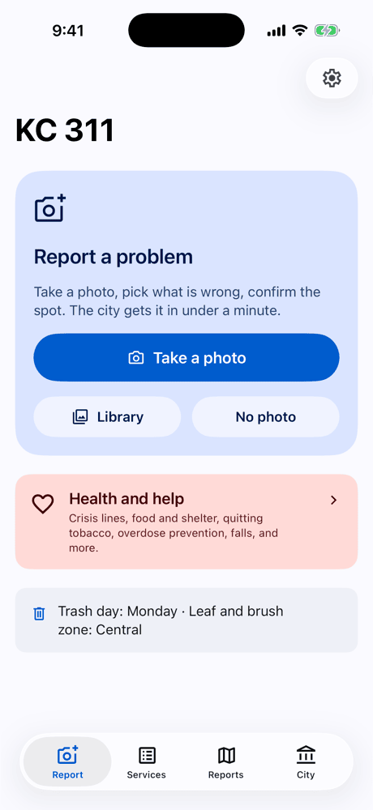
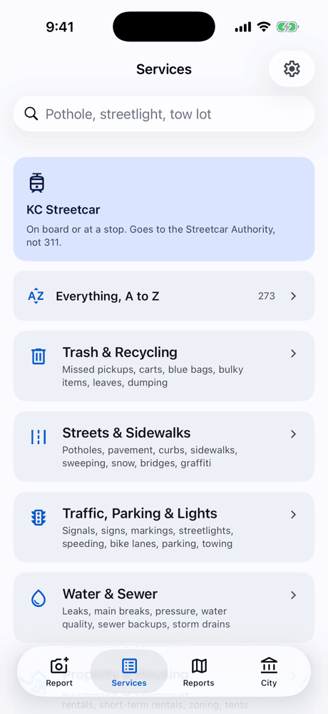
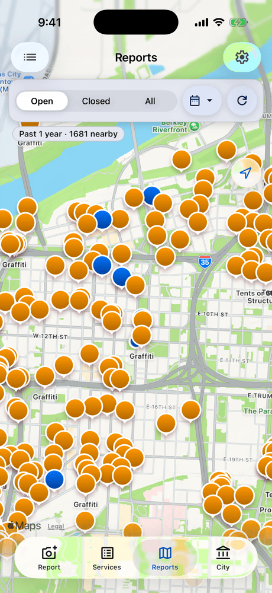
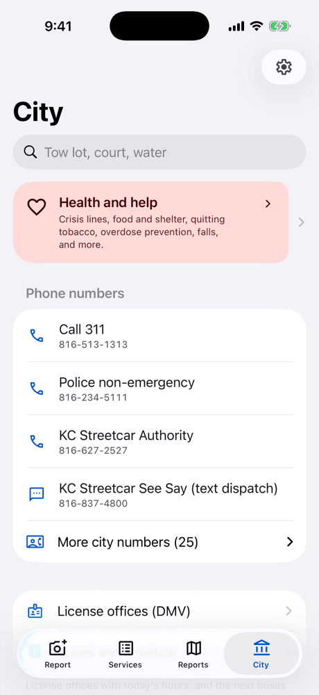

# KC 311

An unofficial iPhone client for Kansas City, Missouri 311, with KC Streetcar
reports added. It uses the same backend as the city's official myKCMO app,
and it uses stock Material Design 3. Testers get it through TestFlight.

> **Unofficial.** This app is not made, approved, or supported by the City of
> Kansas City, Missouri, by Tyler Technologies (the maker of myKCMO and the
> MyCivic platform), or by the KC Streetcar Authority. Reports you file go
> into the city's real 311 system. For an emergency, call 911.

  
  
  
  

## Tabs

- **Report.** Take a photo or pick one from the library, then select the
  problem. "No photo" opens the Services tab. The home screen shows your
  open reports; tap one to see it.
- **Services.** Every service in one place. The city's 41 categories overlap,
  so the app groups them into nine sections (for example Trash & Recycling,
  Water & Sewer). Each section shows its sub-types under their category, and
  the city pages that belong with it, such as the bulky pickup scheduler.
  "Everything, A to Z" lists each report type, page, and phone number.
- **Reports.** Your reports and everyone else's on one map, or in a list.
  - On the map, your reports are dark markers with a person glyph, drawn
    on top of the public pins. Public pins have status colors.
  - In the list, a "Yours" section with your report cards sits above
    "Nearby", which is sorted by distance.
  - An "Everyone / Only mine" chip filters. Open, Closed, All and a time
    scope (1 year by default, 6 months, 90 days, 30 days) apply to both.
  - "Request updates" files a "311 Request Update" for your open reports.
- **City.** City phone numbers (311, police non-emergency, the streetcar, and
  25 more from the city's own catalog text), and the city pages that no
  section claims.

The cog at the top right of each screen opens Settings: the theme (Auto,
Light, Dark), the API status with a manual key refresh, your reports id, and
the credits.

## Filing a report

- Make sure that the pin is at the correct position, answer the city's
  questions, and send. The app fills in the GPS point, the nearest address,
  and the nearest intersection. It uses the photo's GPS when the photo has
  it, else the phone's location.
- The app runs the city's duplicate check before it sends.
- "Show on the public map" is on by default, so neighbors can see the
  report. The city's own default is private. "Send anonymously" leaves out
  your name and contact.
- If the city's server is not available, the report stays in a queue until
  the server is available again.
- **KC Streetcar.** The Streetcar Authority is not part of 311. The app sends
  a text to the See Say line (a dispatcher, for safety and damage) or an
  email to info@kcstreetcar.org (tracker problems, service, feedback), with
  the photo attached.

## Update requests

Update requests open 7 days after a report is filed and 7 days after the
last update request (`Store.tooSoon`). Before that, the button is greyed out
with the date it opens, everywhere in the app. With "Ask automatically" on
(the default), the app files one for each report that has had no movement
and no update request for 7 days. It checks at launch, when it comes to the
foreground, and in background refresh.

## How it works

**The API key.** The official Android app (`com.civicapps.kansascitymo`)
signs each call with an HS256 JWT and a key that ships in the APK. KC 311
gets that key by itself (`KeyRefresher.swift`):
1. It downloads the newest APK from APKPure and unzips its code files.
2. It finds the strings with the shape of the key, the city id, and the app
   version.
3. It keeps the combination that the server accepts.

`APIHealth.swift` checks the API with one signed read at launch, on
foreground, and in background refresh (at most every 6 hours). Any request
that fails for a key or access reason also goes to it. The repair follows the
official app: it asks `get_baseurl` for the current API address, then gets
the key from the newest APK if that does not help. Automatic key downloads
run at most once in 6 hours. A fresh install has its key in approximately 20
seconds. The key is not in this repo.

**No accounts.** KCMO turns off logins, so the server files "my reports"
under a device id. The app makes the id on first launch and saves it in the
iCloud Keychain as well as in its settings. The Keychain copy survives
deleting the app and moves to a new iPhone with the Apple ID. Settings shows
the id and can restore a saved one.

**Case numbers.** Only some categories go to the city's case system
(potholes, trees, animals, bridges, signals). The app reads that number from
`thirdparty_params.case_number`. Other categories (sidewalks, graffiti, carts
and more) are worked inside myKCMO and never get one, so the app shows the
myKCMO report number for them.

**Speed.**
- Every screen shows its saved copy at once and refreshes in the background:
  the catalog (at most every 6 hours), my reports, report details, and map
  pins (after 15 minutes).
- The city's map endpoint takes approximately 6 seconds per call and fails
  for some mixes of categories. The app asks in parallel groups of five and
  splits a failed group. It draws only the 250 pins nearest the map's center,
  because MapKit stalls with thousands of markers.
- The client sends no cookies. With a session cookie, the server handled the
  parallel calls one at a time.

**Times.** The numeric times in `myissues` run hours ahead (`added_on` by 2
hours, `updated_timestamp` by 5 on 2026-10-05). The `updated_on` string is
right, so the filing time is the earlier of the two and never later than
now.

**Data the app does not keep.** The app reads only the fields it shows.
Saved report details leave out all contact fields of other people.

`docs/API.md` records the endpoints and fields.

## Build and ship

    brew install xcodegen
    cp ios/Config/Signing.xcconfig.example ios/Config/Signing.xcconfig   # team id and bundle id prefix
    ios/scripts/build.sh            # unsigned compile check
    ios/scripts/testflight.sh       # archive and upload to TestFlight

`testflight.sh` sets a timestamp build number and bundles only the key, the
city id, and the app version, never a device id. Each tester's install makes
its own id. The app record must exist in App Store Connect first.
`install.sh` installs straight on a paired iPhone. Use it only for an app
that is not on TestFlight.

Optional: put a saved config at `ios/Config/civic-config.json` (or set
`MYCIVIC_CONFIG`) with `key`, `city_id`, and `app_version`, so the first
launch skips the key download.

For screenshots in a headless simulator, use these launch arguments:
- `-startTab 0|2|3|4` for Report, Reports, City, and Services.
- `-startStep category|all|details|sub|streetcar` (`sub` with
  `-startCategory trash`).
- `-nearbyList YES|NO` and `-onlyMine YES|NO` (Reports).
- `-startUpdates YES`, `-openReport YES`, and `-selectPin YES|recent`.
- `-showSettings YES`, `-appearance auto|light|dark`, and `-deviceUID <id>`.

## Ticket alerts

Settings > Ticket alerts turns on a notification for each change that city
staff make to one of your reports, usually within a minute. The KC 311 alert
server (`push/`, a Cloudflare Worker) checks your reports every minute. It
keeps your reports id and this phone's notification token, nothing else.
Turn the switch off to delete them. A tap on an alert opens the report.

## Credits

Provided by [Kansas City Effective Altruism](https://www.eakansascity.org).

See `CREDITS`.

## License

MIT. See `LICENSE`. The software comes with no warranty.
