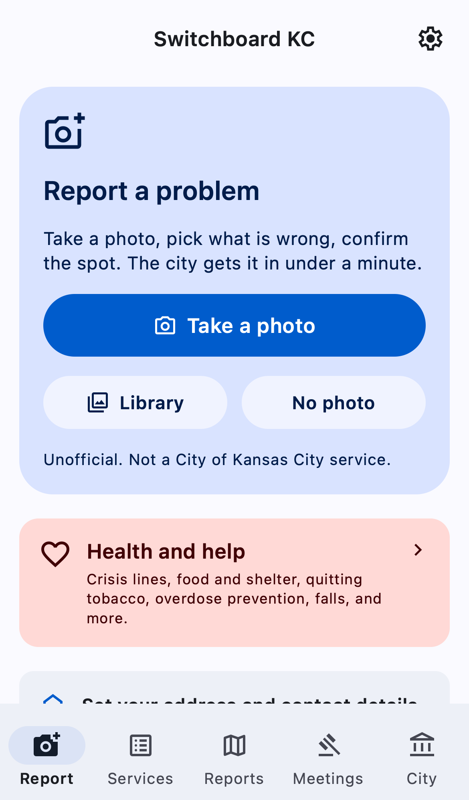
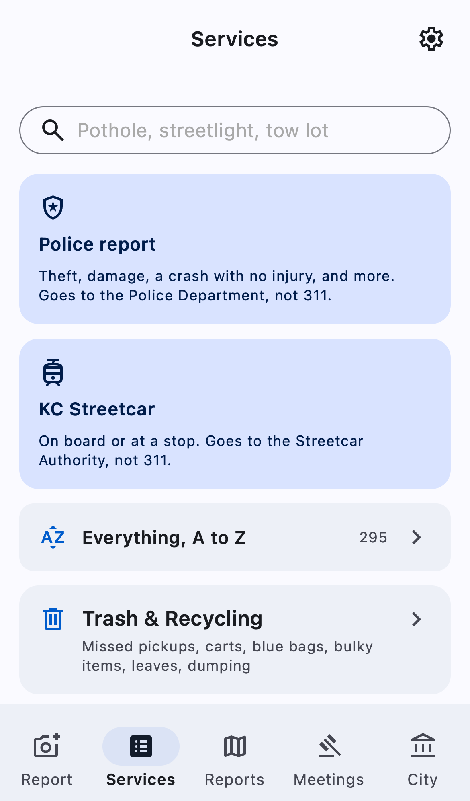
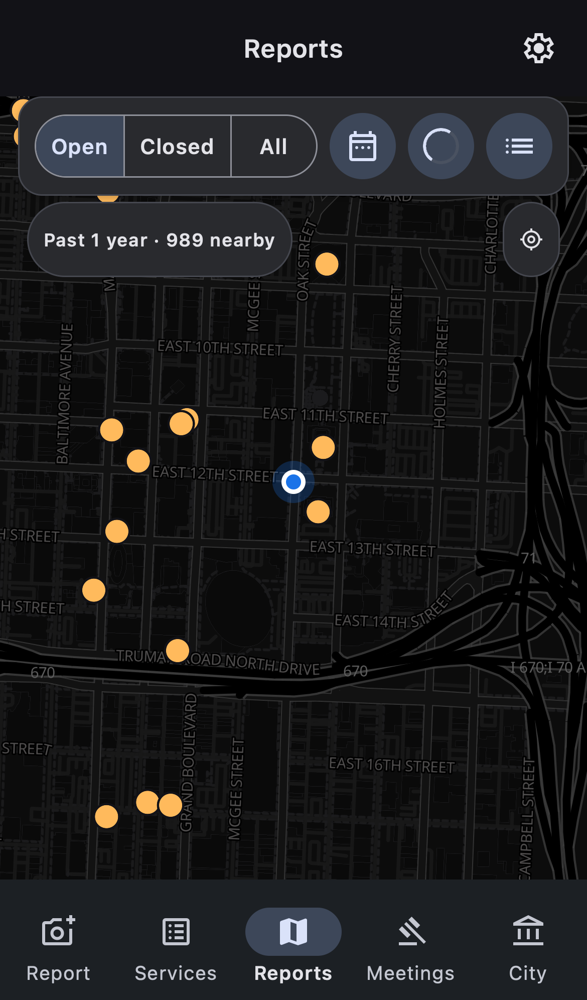
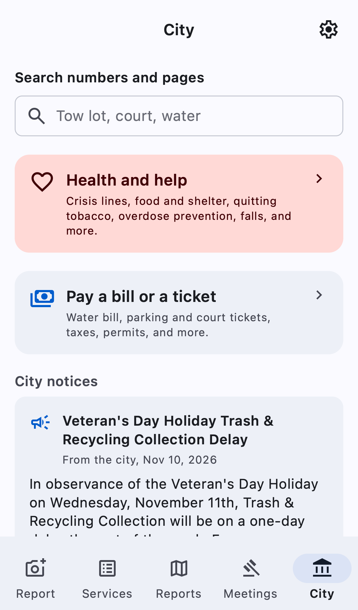

# Switchboard KC

An unofficial client for Kansas City, Missouri 311, with KC Streetcar
reports, city meetings and city services added. It is a web app (`web/`)
that installs from the browser on any phone, with no app store. It uses the
same backend as the city's official myKCMO app, and stock Material Design 3.

The owner's server is at **https://switchboard.commonlot.io**. Anyone can
open it.

> **Unofficial.** This app is not made, approved, or supported by the City of
> Kansas City, Missouri, by Tyler Technologies (the maker of myKCMO and the
> MyCivic platform), or by the KC Streetcar Authority. Reports you file go
> into the city's real 311 system. For an emergency, call 911.

  
  
  
  

The project was called KC 311 until October 2026. Until November 2026 it
also had an iPhone app, and the web app started as a port of it. A comment
or a test that names a `.swift` file refers to that app. Its last version is
at the git tag `iphone-app-final`.

## Tabs

- **Report.** Take a photo or pick one from the library, then select the
  problem. "No photo" opens the Services tab. The home screen shows your
  open reports; tap one to see it.
  - A card asks one time for your home address and your contact details.
    The address gives your trash day, your leaf and brush zone, and when
    your street was plowed. The app keeps both on your device only.
- **Services.** Every service in one place. The city's 41 categories overlap,
  so the app groups them into nine sections (for example Trash & Recycling,
  Water & Sewer). Each section shows its sub-types under their category, and
  the city pages that belong with it, such as the bulky pickup scheduler.
  "Everything, A to Z" lists each report type, page, and phone number.
  - Two cards at the top go to offices that are not part of 311. "Police
    report" shows the police department's conditions for an online report
    and its report types, opens the department's own form, and tells how to
    get a copy of a report. "KC Streetcar" writes a report to the Streetcar
    Authority.
- **Reports.** Your reports and everyone else's, in a list or on one map.
  - On the map, your reports are dark markers with a person glyph, drawn
    on top of the public pins. Public pins have status colors.
  - In the list, a "Yours" section with your report cards sits above
    "Nearby", which is sorted by distance.
  - An "Everyone / Only mine" chip filters. Open, Closed, All and a time
    scope (1 year by default, 6 months, 90 days, 30 days) apply to both.
  - The tab opens on the list of your own reports, open and closed. With
    no reports of your own, it shows everyone's open reports. It keeps the
    choices that you make after that.
  - "Request updates" files a "311 Request Update" for your open reports.
  - "Add a note" on one of your reports sends a note and up to 4 photos to
    the staff. The note can go on the report or on one of its update
    requests: pick one in the box, or use "Add a note to this request" on
    the request's entry in the timeline. It goes into that history, and it
    cannot be changed or deleted. The box shows only when the city allows
    notes on that report or request.
  - "Rate the city's work" on one of your resolved or closed reports sends
    1 to 5 stars and an optional comment to the city's 311 system. A report
    takes one rating, and it cannot be changed.
- **Meetings.** The meetings of the City Council, its committees and the
  city's boards, with the agenda, the way to join, the rule for public
  comment, and calendar subscriptions. The list comes from
  [Common Lot](https://github.com/BaesTheorem/common-lot).
- **City.** Health and help (crisis lines, food, shelter, clinics), city
  phone numbers (311, police non-emergency, the streetcar, and 25 more from
  the city's own catalog text), license offices, buses and the streetcar,
  and the city pages that no section claims.
  - City notices: what the city sends to every phone with its own app, for
    example a holiday trash delay. The Report tab shows a notice above your
    trash day until you hide it. The City tab keeps the list.
  - "Pay a bill or a ticket" lists each payment the city takes online and
    opens the payment page of the office that owns it.

The cog at the top right of each screen opens Settings: the theme (Auto,
Light, Dark), your details, ticket alerts, your reports id with the ways to
keep it, the API status with a manual key refresh, and the credits.

## Filing a report

- Make sure that the pin is at the correct position, answer the city's
  questions, and send. The app fills in the GPS point, the nearest address,
  and the nearest intersection. It uses the photo's GPS when the photo has
  it, else the phone's location.
- The app runs the city's duplicate check before it sends.
- "Show on the public map" is on by default, so neighbors can see the
  report. The city's own default is private. "Send anonymously" leaves out
  your name and contact.
- If the city's server is not available, the report stays in a queue until
  the server is available again.
- **KC Streetcar.** The Streetcar Authority is not part of 311. The app sends
  a text to the See Say line (a dispatcher, for safety and damage) or an
  email to info@kcstreetcar.org (tracker problems, service, feedback), with
  the photo attached.

## Update requests

Update requests open 7 days after a report is filed and 7 days after the
last update request. Before that, the button is greyed out with the date it
opens, everywhere in the app. With "Ask automatically" on (the default), the
app files one for each report that has had no movement and no update request
for 7 days. It checks when it opens and when it comes to the foreground.

With ticket alerts on, the app also asks while it is closed. The server
finds the report that is due and pushes an "ask" to your device, and the
device sends the request that it kept. Your email or phone stays on the
device and goes to the city only inside a request. `web/worker/asks.js` has
the sequence.

## Ticket alerts

Settings > Ticket alerts turns on a notification for each change that city
staff make to one of your reports, usually in approximately one minute. The
server checks your reports each minute. It keeps your reports id, this
browser's push address, and the times and titles of the timeline entries
that it sent already. Turn the switch off to delete them. A tap on an alert opens the report. On an iPhone or an iPad, alerts
need the app on the Home Screen (iOS 16.4 or later).

## How it works

**The server.** A browser cannot call the city's API itself: the API sends
no CORS headers, and its signing key must not be in public JavaScript. So
the app comes with a small server, a Cloudflare Worker (`web/worker/`), that
serves the app's files and forwards only the calls that the app makes.
`web/README.md` explains the design, the limits, and the data that the
server keeps.

**The API key.** The official Android app (`com.civicapps.kansascitymo`)
signs each call with an HS256 JWT and a key that ships in the APK. The
server keeps that key. When the city rejects it, the app downloads the
newest APK through the server and reads the strings with the shape of the
key, and the server saves the first one that the city accepts. The key is
not in this repo.

**No accounts.** KCMO turns off logins, so the city files "my reports" under
a device id. The app makes the id on first use and keeps it on the device.
Settings can copy it, save it as a file, save it to a passkey, and restore
it. The passkey is storage, not a login: a password manager carries the id
to your other devices.

**Case numbers.** Only some categories go to the city's case system
(potholes, trees, animals, bridges, signals). The app reads that number from
`thirdparty_params.case_number`. Other categories (sidewalks, graffiti, carts
and more) are worked inside myKCMO and never get one, so the app shows the
myKCMO report number for them.

**Speed.**
- Each screen shows its saved copy at once and refreshes in the background:
  the report types (kept 6 hours), my reports, report details, and map pins
  (kept 15 minutes).
- The city's map endpoint takes approximately 6 seconds for each call and
  fails for some mixes of categories. The app asks in groups of five, all at
  the same time, and splits a group that fails.
- The server sends the city no cookies. With a session cookie, the city
  handled parallel calls one at a time.

**Times.** The numeric times in `myissues` run hours ahead (`added_on` by 2
hours, `updated_timestamp` by 5 on 2026-10-05). The `updated_on` string is
right, so the filing time is the earlier of the two and never later than
now.

**Data the app does not keep.** The app reads only the fields that it shows.
The server removes the reporter's contact fields from each report detail
before the detail leaves the server.

`docs/API.md` records the endpoints and fields. `docs/ROADMAP.md` lists what
is open.

## Run your own server

Anyone can run a copy on Cloudflare's free plan, for a household or a
neighborhood group:

The button asks for an owner token. Open your server, and enter the token in
Settings > Owner tools. Then send the server's address to the people who will
use it. Anyone with the address can use a server, and its owner can pause
it. The steps, and the commands to build and test, are in `web/README.md`.

## Credits

Provided by [Kansas City Effective Altruism](https://www.eakansascity.org).

See `CREDITS`.

## License

MIT. See `LICENSE`. The software comes with no warranty.
