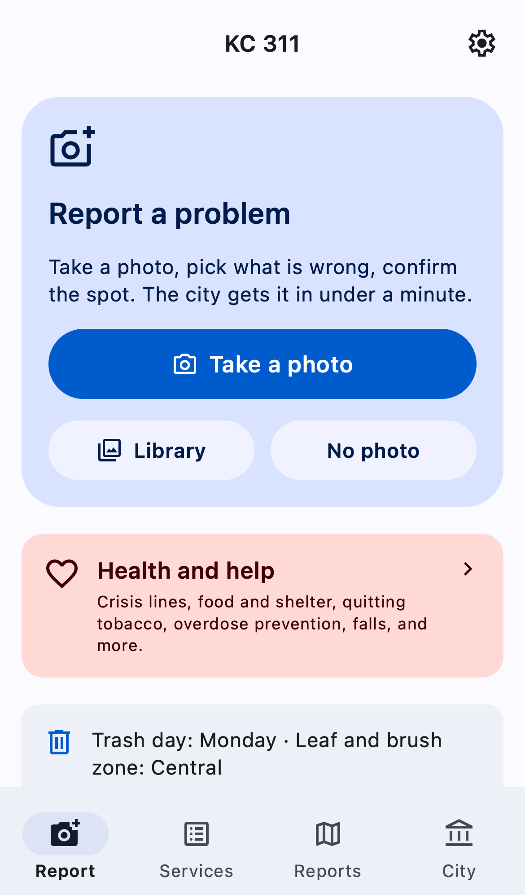
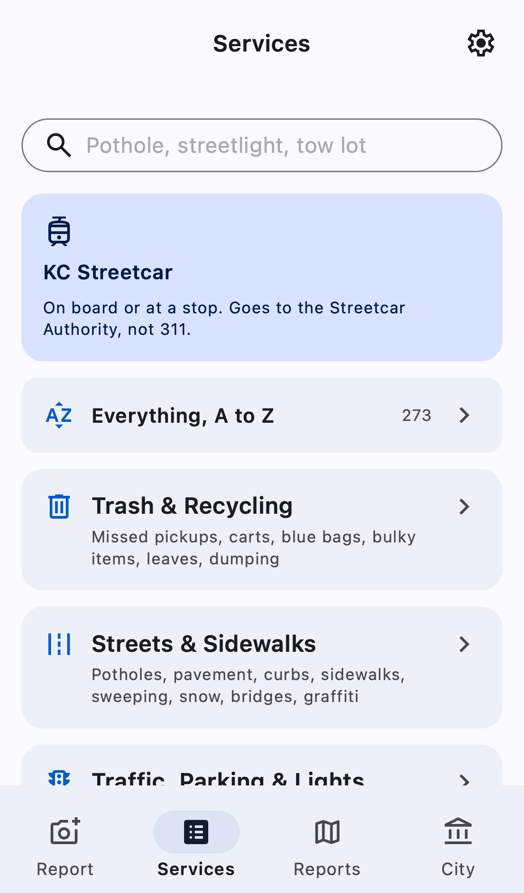
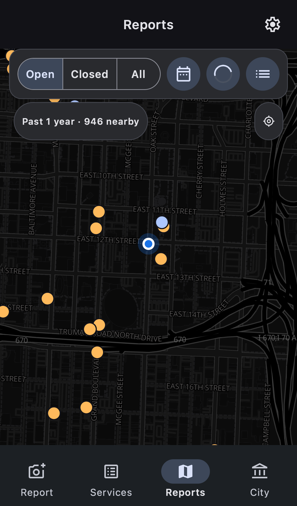
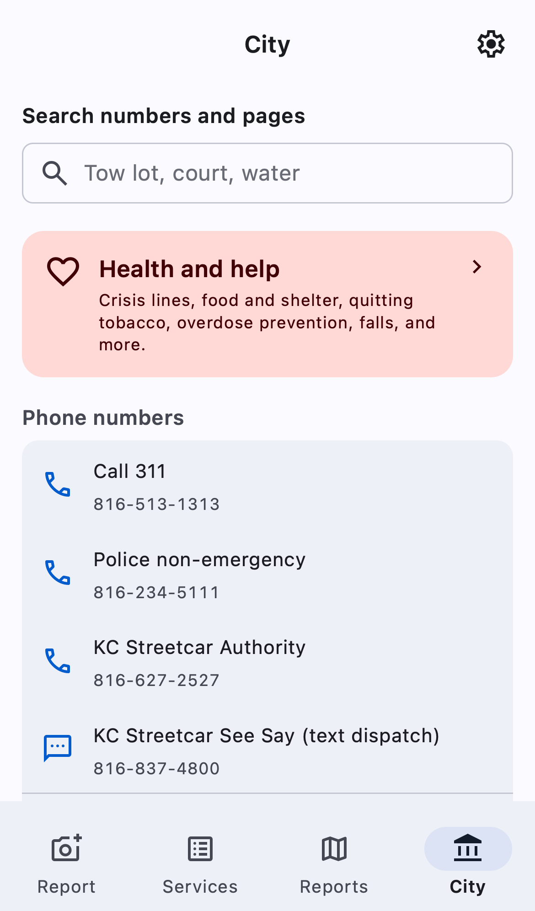

# Switchboard KC on the web

The web version of Switchboard KC: the same four tabs as the iPhone app
(Report, Services, Reports, City), in any modern browser. It installs to the
home screen as an app and has ticket alerts. The iPhone app is in `../ios`.

> **Unofficial.** This app is not made, approved, or supported by the City of
> Kansas City, Missouri, by Tyler Technologies (the maker of myKCMO and the
> MyCivic platform), or by the KC Streetcar Authority. Reports you file go
> into the city's real 311 system. For an emergency, call 911.

  
  
  
  

## How it works

A browser cannot call the city's API itself: the API sends no CORS headers,
and its signing key must not be in public JavaScript. So the app comes with a
small server, a Cloudflare Worker (`worker/`). The Worker serves the app's
files and forwards the eight API calls the app makes:

| App action | City endpoint |
| --- | --- |
| Report types (kept 6 hours) | `get_main` |
| My reports | `myissues` (every page) |
| One of my reports | `get_issue_detail_citizen` |
| A public report | `reported_issue_detail` |
| Public map | `reported_issues_map` |
| Duplicate check | `check_duplicate_issue` |
| File a report or an update request | `report_an_issue` |
| A note on one of my reports | `add_comments_citizen` |
| A moved API base | `token/get_baseurl` |

The Worker builds each call from checked fields. It is not an open proxy: a
report must name this city, the app's report menu, and the caller's own
reports id, and a map point must be in Kansas City. Reporter contact fields
are removed from every report detail before it leaves the Worker.

Everything else the app shows comes from open data that browsers can read
directly: the city's own address locator (MyKCMO), US Census TIGER roads,
the city's and the state's ArcGIS layers, and data.mo.gov. Two sources send
no CORS headers, so the Worker relays them: HUD housing counselors and the
RideKC schedule (`worker/open.js`).

**The city key.** The key ships inside the city's Android app. The Worker
keeps it in KV. When the city rejects it, the app downloads the newest APK
through the Worker, reads the key candidates in the browser, and the Worker
saves the first candidate the city accepts (`worker/keys.js`). The owner can
also set the key directly (`POST /api/admin/key`).

**Your reports id.** The city has no accounts: it files "my reports" under a
device id. The app makes one on first use and keeps it on the device. Settings
can copy it, save it as a file, and restore it. The same id works in the
iPhone app.

**Ticket alerts.** The Worker reads each subscribed id's reports every minute
and sends a Web Push notification when city staff change one
(`worker/push.js`). On iPhone and iPad, web push works only for an app added
to the Home Screen (iOS 16.4 and later).

**Offline.** The service worker keeps the app's files, so the app opens with
no connection. A report filed offline waits in a queue on the device and goes
out when the server answers.

## Who can use a server

| Mode | Who | Set with |
| --- | --- | --- |
| `open` (default) | Anyone with the address; Cloudflare Turnstile guards filing when `TURNSTILE_SECRET` is set | `MODE` in `wrangler.jsonc`, or Settings > Owner tools |
| `off` | Nobody: every city call answers 503, and the app still opens | the same |

Limits on every server: 150 reads a minute and 4 reports a minute per IP
address, and `SUBMIT_DAILY` reports a day per IP address (10 by default). The
daily counts live in one SQLite Durable Object (`worker/ledger.js`), so two
requests at the same moment cannot both take the last report of the day.
People who share one IP address (a household, an office, some phone
carriers) share these limits.

## Run your own server

A server costs nothing on Cloudflare's free plan for a household or a
neighborhood group.

1. Click the button and sign in to Cloudflare.
2. When it asks for `ADMIN_TOKEN`, paste a long random string. Keep a copy.
3. When the deploy is done, open your server's address.
4. Open **Settings > Owner tools**, and paste the `ADMIN_TOKEN`.
5. Use the app once. If the server has no city key yet, it gets one from the city's app.
6. Send your server's address to the people who will use it. They can add it to the Home Screen.

To deploy from a computer instead:

    cd web
    npm install
    node bin/vendor.mjs          # only after changing dependencies or icons
    npx wrangler login
    npx wrangler deploy
    npx wrangler secret put ADMIN_TOKEN

`bin/deploy.mjs` does the same with the values in `web/.env` (gitignored),
and gives the server its first city key from `../ios/Config/civic-config.json`
when that file exists.

## Data the server keeps

Cloudflare KV holds:

- the city key and API base,
- for ticket alerts: each subscribed reports id with its push addresses, and
  which timeline entries were already sent (times and titles only),
- a cached copy of the report types.

The ledger Durable Object holds the daily report count for each IP address,
and deletes each count after three days.

It keeps no report text, no address, no photo, and no contact details. The
app keeps your reports, drafts, and contact details on your device only.

## Security

- A strict Content-Security-Policy (`public/_headers`): scripts from this
  origin only, no inline scripts, no framing.
- All city text is escaped when it is drawn (`public/js/lib/html.js`).
- Cross-site requests to `/api` are refused, so another web page cannot use
  a visitor's browser to drive the server.
- The owner token is compared in constant time and never sent to the city.

## Develop and test

    npm test                     # unit tests (node --test), about 2 s
    node test/smoke.mjs          # read-only checks of a deployed server
    npx playwright test          # browser tests: WebKit as an iPhone, Chromium as an Android phone
    node test/screens.mjs        # the screenshots above, light and dark

The browser tests read real city data and never file a report. Each test
page sends `x-kc311-dry-run: 1`, so the server checks a report and then does
not pass it on. Service workers are off in the tests, because Playwright's
request mocks do not see a page that a service worker controls.

`DESIGN.md` records the design. `../docs/WEB-PARITY.md` compares each screen
with the iPhone app. `../docs/API.md` records the city's API.

## Credits

Maps: [MapLibre GL JS](https://maplibre.org) with tiles from
[OpenFreeMap](https://openfreemap.org), © OpenMapTiles, © OpenStreetMap
contributors. Interface: [Beer CSS](https://www.beercss.com) and Material
Symbols. Provided by [Kansas City Effective Altruism](https://www.eakansascity.org).
